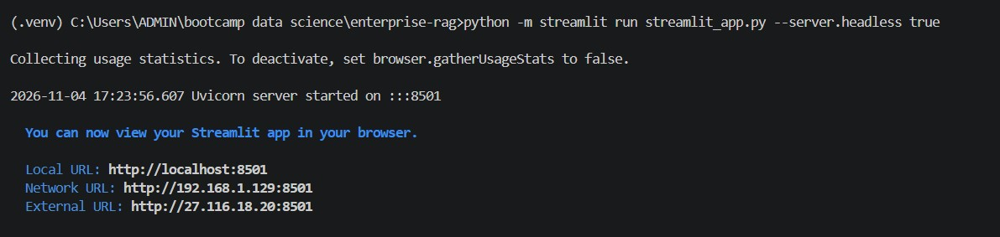
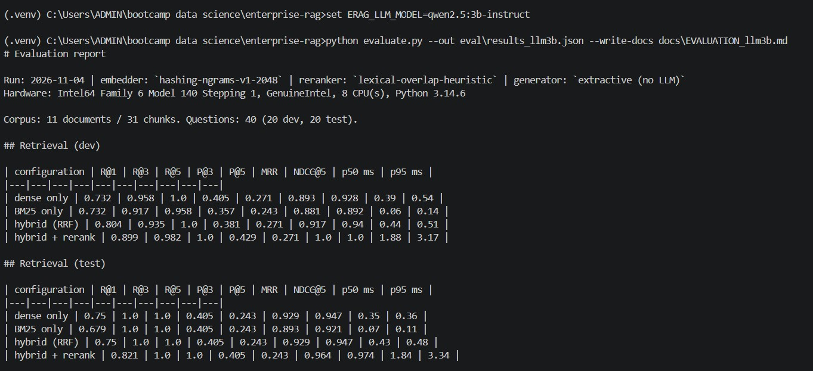
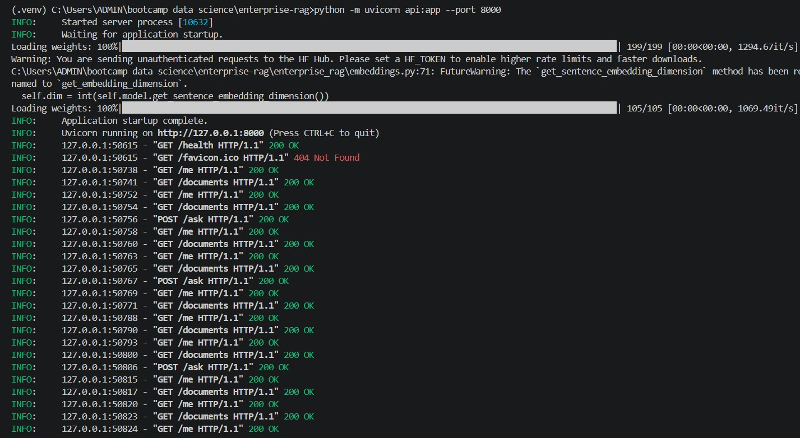
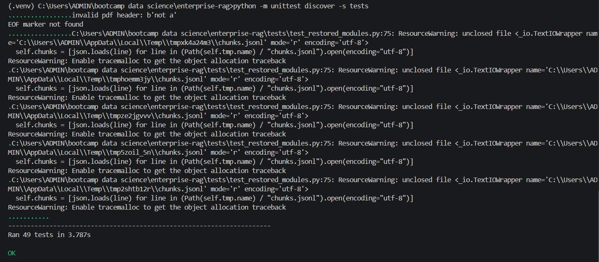
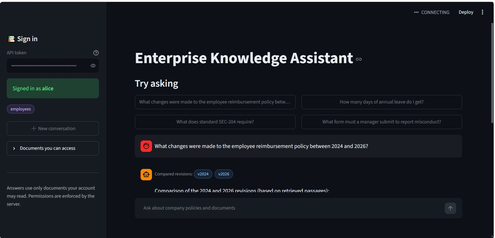
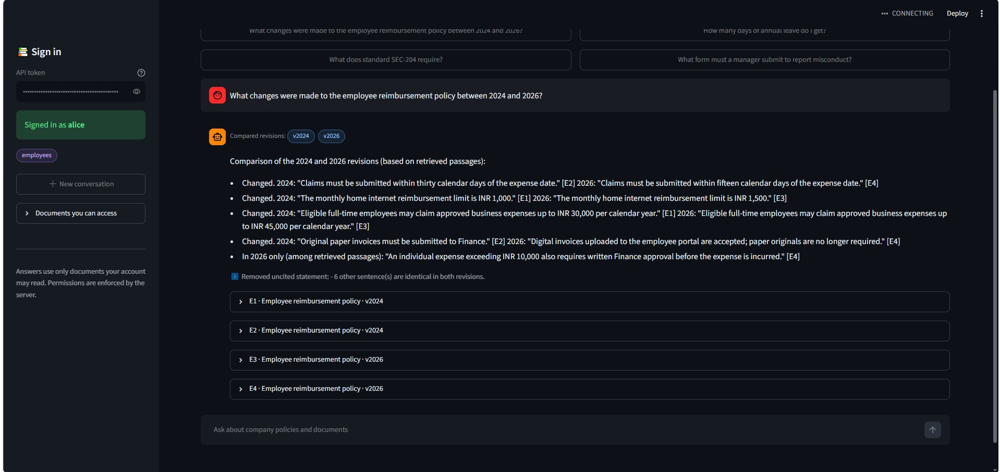

# Enterprise Knowledge Intelligence System

Advanced RAG + hybrid retrieval + conversational RAG over company documents (PDF, Word, Excel,
HTML, Markdown, text) with version-aware comparison, citations, and permission-controlled retrieval.
Spec: `docs/PROJECT_SPEC.md`. Evaluation: `docs/EVALUATION.md`. Recovery history: `docs/RECOVERY_NOTES.md`.

## What runs where (read this first)

| Component | Offline default (works anywhere) | Real target (needs downloads / services) |
|---|---|---|
| Parsing, semantic chunking, BM25, RRF, access control, sessions, audit | yes | - |
| Embeddings | `hashing` (lexical stand-in) | `bge-small`, `bge-m3` (`requirements-ml.txt`) |
| Vector store | in-memory | Qdrant (`ERAG_VECTOR_STORE=qdrant`) |
| Reranker | `lexical` heuristic | `cross-encoder` |
| Answers | extractive quotes with citations | Qwen/Llama through any OpenAI-compatible server such as Ollama (`ERAG_LLM_URL`) |
| Database | SQLite | PostgreSQL (`ERAG_DATABASE_URL=postgresql://...`) |
| API / UI / Docker | `api.py`, `streamlit_app.py`, `Dockerfile`, `docker-compose.yml` | same |

Verified here (Python 3.12, no network): everything in the "offline default" column, the CLI,
`manage.py`, `evaluate.py` and 41 tests. **Not executed here:** FastAPI, Streamlit, Docker, PostgreSQL,
Qdrant, BGE models, the cross-encoder, any LLM, LangChain, and Python 3.14. Treat those as untested
until you run them.

## Quick start (Linux/macOS; on Windows use `.venv\Scripts\python.exe` in place of `python`)

```bash
python3 -m venv .venv && source .venv/bin/activate
pip install -r requirements.txt
python manage.py build          # parse + semantic chunking + index; registers documents
python manage.py seed-demo      # demo users; tokens printed once and saved to data/demo_tokens.json
python ask.py --user alice "What changes were made to the employee reimbursement policy between 2024 and 2026?"
python ask.py --user bob        # interactive; try the follow-up: "What about the submission deadline?"
python ask.py --user alice "What form must a manager submit to report misconduct?"   # refused: HR only
python ask.py --user carol "What form must a manager submit to report misconduct?"   # answered: HR-17
python -m unittest discover -s tests
python evaluate.py
```

Sample corpus: `python create_demo_files.py` (Word/HTML/Excel) and `python create_extra_corpus.py`
(HR/Finance/PDF; needs `pip install -r requirements-dev.txt`). Generated files are already included.

## API and UI

```bash
uvicorn api:app --port 8000                      # then: curl -H "Authorization: Bearer <token>" ...
streamlit run streamlit_app.py                   # sign in with a demo token
```

Endpoints: `GET /health`, `GET /me`, `POST /ask`, `POST /sessions`, `GET /sessions/{id}/history`,
`DELETE /sessions/{id}`, `GET /documents`, and admin-only `POST /documents`,
`PATCH /documents/{id}/permissions`, `DELETE /documents/{id}`.
Groups are read from the database for every request; the client cannot supply them.

## Real models

```bash
pip install -r requirements-ml.txt
export ERAG_EMBEDDER=bge-small ERAG_RERANKER=cross-encoder
export ERAG_LLM_URL=http://localhost:11434/v1 ERAG_LLM_MODEL=qwen2.5:3b-instruct   # after `ollama pull`
python manage.py build && python evaluate.py     # re-measure: offline numbers do not transfer
```

All settings are `ERAG_*` environment variables (`enterprise_rag/settings.py`). Docker: copy
`.env.example` to `.env`, then `docker compose up --build` (see comments in `docker-compose.yml`).

## Layout

`enterprise_rag/` parsers, `semantic_chunking.py`, `embeddings.py`, `vector_store.py`, `lexical.py`
(BM25), `fusion.py` (RRF), `rerank.py`, `retrieval.py`, `rag.py` (understanding, comparison, citations,
abstention), `service.py` + `db.py` (sessions, auth, audit), `factory.py`, `evaluation.py`;
`config/documents.json` document registry; `eval/questions.jsonl` labelled questions.

## Results (40 labelled questions, 11 fictional documents; see docs/)

| | Offline stand-ins | BGE + cross-encoder, quoted answers | BGE + cross-encoder + Qwen 2.5 1.5b |
|---|---|---|---|
| Recall@1, test, hybrid + rerank | 0.821 | 0.893 | 0.893 |
| Answer correctness, dev / test | 0.955 / 0.952 | 0.955 / 0.952 | 0.864 / 0.857 |
| Permission leaks | 0 | 0 | 0 |
| Answer latency p50 | ~3 ms | ~340 ms | ~4 s |

Limitations: the corpus is tiny and synthetic, 40 questions cannot separate configurations, faithfulness is a
lexical proxy (not an entailment judge), and the 1.5b model scored lower than plain quoted answers.
Not verified: Docker, Qdrant, PostgreSQL and LangChain code paths.
"# enterprise-knowledge-assistant" 


## 📸 Application Screenshots

### 1. Streamlit Application Startup



### 2. RAG Retrieval Evaluation Metrics



### 3. FastAPI Backend Execution



### 4. Automated Testing Results



### 5. Enterprise Knowledge Assistant Dashboard



### 6. Policy Comparison and Source Citations



---